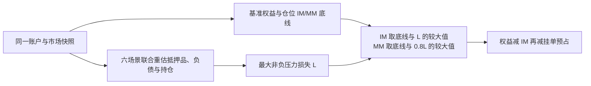

# 风险模型与已知限制

## 两条计算路径

| 入口 | 风险要求与状态 |
| --- | --- |
| `lab` / `Simulator` → `calculate_portfolio` | 六场景 PM、保守挂单预占、FIFO 成本、持久化账户事务 |
| `serve` / `demo` → `calculate_risk`、`check_order` | 固定费率独立示例；订单检查假设立即全部成交，不接入持久化账户 |

两条路径共用 [数据模型](../uta/models.py) 和 [精确金额计算](../uta/risk.py)，但它们的 IM/MM、下单及清算行为不同。本页先说明主链路，再保留独立示例公式。

## 六场景组合保证金

[calculate_portfolio](../uta/portfolio.py) 的模型版本为 `linear-pm-v1`。产品范围限于 USD、BTC、ETH 与 BTC-PERP、ETH-PERP；USD 的价格和抵押系数必须均为 1。模拟器默认 BTC/ETH 抵押系数为 0.8/0.75，合约 IM 底线率为 10%/12%、MM 底线率为 6%/7%，配置来源为 [simulator.py](../uta/simulator.py)。这些是项目自定义参数。

对每种资产，先按总资产计算折扣抵押品，再按全额价格计入负债。允许输入同币种正资产和显式负债；不能先净额化，也不能同时用该币种负余额与正的显式负债重复表示借款。

- 基准权益 `E0` = 折扣后正资产价值 − 负余额及显式负债的全额价值 + 持仓未实现损益。
- 持仓损益 = `有符号数量 × 标记价格 − 有符号入场成本`。模拟器保存精确 FIFO `entry_notional`；展示用平均 `entry_price` 可能经过舍入，不用于替代该成本。
- 每个场景同时冲击抵押品价格、负债价格与合约标记价，得到权益 `Es`；场景损失 `Ls = E0 − Es`，获利场景允许负损失。
- 压力损失 `L = max(0, 所有 Ls)`。
- `IM = max(各仓位绝对名义价值 × IM 底线率之和, L)`。
- `MM = max(各仓位绝对名义价值 × MM 底线率之和, 0.8 × L)`。
- 可用保证金 = `E0 − IM − 所有 OPEN 订单预占`；展示比率为 `E0 / MM`，MM 为零时为 `None`。



### 场景集

以下数值是相对当前快照的百分比变化。USD 不发生冲击；现货变化也用于重估对应币种负债。

| 场景 | BTC 现货 | ETH 现货 | BTC 合约标记价 | ETH 合约标记价 |
| --- | ---: | ---: | ---: | ---: |
| `market_down` | -15% | -20% | -15% | -20% |
| `market_up` | +15% | +20% | +15% | +20% |
| `btc_down_eth_up` | -12% | +12% | -12% | +12% |
| `btc_up_eth_down` | +12% | -12% | +12% | -12% |
| `collateral_gap_down` | -18% | -25% | +8% | +12% |
| `collateral_gap_up` | +18% | +25% | -8% | -12% |

组合抵消仅在这组联合冲击中体现；相关性变化与基差场景仍可产生保证金要求。六个离散场景不能证明覆盖所有市场风险，也不代表任何交易所 PM 规则。

### 挂单预占

[position_im_bound](../uta/portfolio.py) 为每单位数量给出固定行情下的 IM 变化上界：`标记价 × max(IM 底线率, 此合约的最大绝对场景冲击)`。对每张 OPEN 订单的有符号剩余数量 `q`，模拟器 [_reserve](../uta/simulator.py) 计算：

```text
预占 = abs(q) × 每单位 IM 上界
     + max(0, q × (限价 − 标记价) + abs(q) × 限价 × 手续费率)
```

例如 BTC 标记价 60,000、IM 底线率 10% 时，每单位上界为 9,000。买入 0.01、限价 60,000、费率 0.001 的订单预占为 `90 + 0.6 = 90.6 USD`。下单后可用保证金必须非负；成交前会按最新报价重新计算全部未成交量的预占，成交后还会重新检查 PM。保守预占可拒绝能降低净风险的普通订单；模拟器没有单独的用户只减仓订单类型。

### 可复算 PM 案例

[test_portfolio.py](../tests/test_portfolio.py) 的手算案例使用 USD 1,000、BTC 正资产 2 与负债 1、ETH 负债 0.5；BTC/ETH 价格 100/200，BTC 抵押系数 0.8；BTC 多头 1、成本 90，ETH 空头 1、成本 180，订单占用 7。该测试为两合约分别配置 IM 10%、MM 5%，与模拟器默认参数分开。

基准权益为 `1000 + 160 − 100 − 100 + 10 − 20 = 950`。最坏场景 `btc_down_eth_up` 下，抵押品变化 -19.2、负债对权益影响 0、持仓变化 -36，损失 55.2。IM 底线 30、MM 底线 15，因此 IM 为 55.2，MM 为 44.16，可用保证金为 `950 − 55.2 − 7 = 887.8`。

## 固定费率独立示例

本节的 `uta.risk` 独立计算采用单一 USD 报告单位、线性永续合约模型。输入和金额输出使用 `Decimal`；加、减、乘的内部计算先转换为精确有理数 `Fraction`，金额结果精确转换回十进制，不依赖调用方的 Decimal 精度。风险参数和资产价格由调用方提供。六场景 PM 同样复用这套精确金额运算。

### 数值精度和输入边界

- 风险模型的每个数值输入必须是有限 `Decimal`，尾数最多 80 位，十进制指数绝对值不超过 100；非零值的调整后指数（`adjusted()`）绝对值也不得超过 100。超出范围、非有限值或浮点数会被拒绝并抛出 `RiskInputError`。
- 权益、保证金、可用额度和模拟订单金额使用精确有理数运算；转换回 `Decimal` 之前会检查结果能否以有限十进制表示。若不能，会报错而不会静默舍入。
- 示例保证金比率涉及除法，作为展示值使用 **34 位有效数字、ROUND_HALF_EVEN（最近值，平局取偶）**舍入；维持保证金为零时该值为 `None`。与金额精确运算不同，展示比率可能被舍入。
- 这些数值边界与舍入规则是此原型的工程选择，不代表任何交易所的精度、结算规则或风险率定义。生产系统还需要按目标资产与产品配置最小单位、分阶段舍入和溢出策略。

对于资产余额，正余额按 `数量 × 价格 × 抵押品折扣系数` 计算，负余额按 `数量 × 价格` 全额计入。可通过单独的 liabilities 提供同币种总借款和利息；不得对同一币种同时提供负余额和正的显式负债，以免重复计入。同币种的正资产和负债不能先净额化，因为抵押系数仅适用于正资产。未提供 `entry_notional` 时，合约未实现盈亏为 `有符号持仓数量 × (标记价格 − 入场价格)`；提供时直接扣除该精确有符号入场成本。

- 折扣后权益 = 折扣后的正资产价值 + 负余额价值 − 显式负债价值 + 所有持仓未实现盈亏。
- 初始保证金 = 各合约 `持仓绝对数量 × 标记价格 × 初始保证金率` 之和。
- 维持保证金 = 各合约 `持仓绝对数量 × 标记价格 × 维持保证金率` 之和。
- 可用保证金 = 折扣后权益 − 初始保证金 − 现有订单占用。
- 本模型保证金比率 = 折扣后权益 ÷ 维持保证金；维持保证金为零时没有比率值。

该比率定义仅供本项目使用，不应与任何交易所的风险率、MMR 或 UniMMR 直接比较。这里没有跨资产风险抵消、压力情景或期权定价，不能称为经过验证的交易所 PM 计算。

### 独立下单检查

检查函数假设订单按给定成交价格**立即全部成交**。它以成交后净仓更新该合约的初始保证金，并将成交价格与标记价格之间的差额及估计手续费计入权益。若计算出的成交后可用保证金大于等于零，则通过该模拟检查。

这个结论不构成订单接纳或成交。调用方必须提供保守成交价格、充分的其他订单占用和新鲜一致的数据，并对检查与预留进行串行化或原子化；否则并发下单、部分成交及行情变化都可能使检查结果失效。模型对减仓订单同样保留既有订单占用，并不尝试覆盖真实交易所的特殊减仓规则。

## 两种清算实现

持久化模拟器的健康状态、实际模拟减仓和残余负债处理位于 [simulator.py](../uta/simulator.py)，清算流程见 [关键业务流程](workflows.md)。它使用六场景 MM，过期行情优先标为 STALE，健康判断没有 1.10 倍恢复缓冲。

下面的确认和恢复规则仅适用于 [LiquidationController](../uta/liquidation.py) 这个独立内存示例：

在完整且新鲜的风险快照中，权益小于或等于维持保证金时，模拟器提出撤销所有订单；在明确确认撤单成功后，必须基于严格更新的快照重新检查，才可能提出 `reduce_only` 减仓。恢复门槛使用 `权益 > 1.10 × 维持保证金` 的示例缓冲。该阈值只是演示参数，不表示任何交易所规则。恢复门槛和减仓数量上限按精确值比较。

缺失、过期或时间倒退的快照使状态进入阻断；未确认动作重试采用相同动作 ID，重复成功确认在内存中去重。模拟器不会提交撤单、撮合成交或改变真实仓位。动作 ID 的跨进程持久化、交易所幂等性和状态对账均需生产系统另行实现。

## 不覆盖的风险

固定费率路径没有场景扫描和跨资产抵消；六场景路径则只覆盖上文列出的离散联合冲击。持久化模拟器包含固定清算滑点、费用及残余 USD 负债，但没有真实流动性、保险基金或 ADL。两条路径都不自动计提借贷利息和资金费，也没有阶梯保证金、期权、资产集中度或外部参数校准。

纯计算函数不检查数据时效或跨来源一致性。模拟器检查账户行情时间，经典导入检查源快照时间；这些检查不能认证价格来源或证明跨接口快照原子性。不能根据本项目结果推断真实账户的清算价、安全性或实际可承受跌幅。
