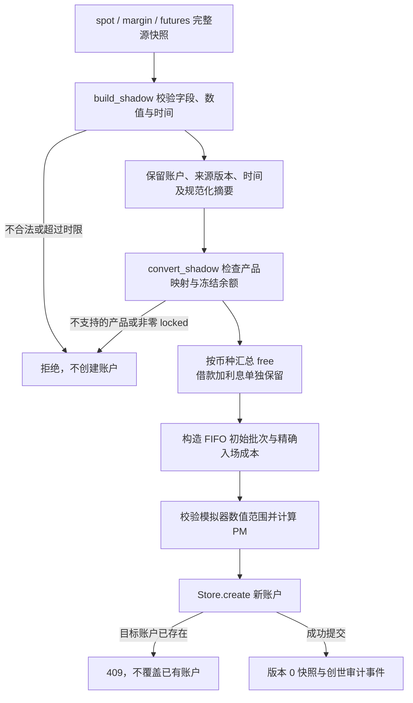
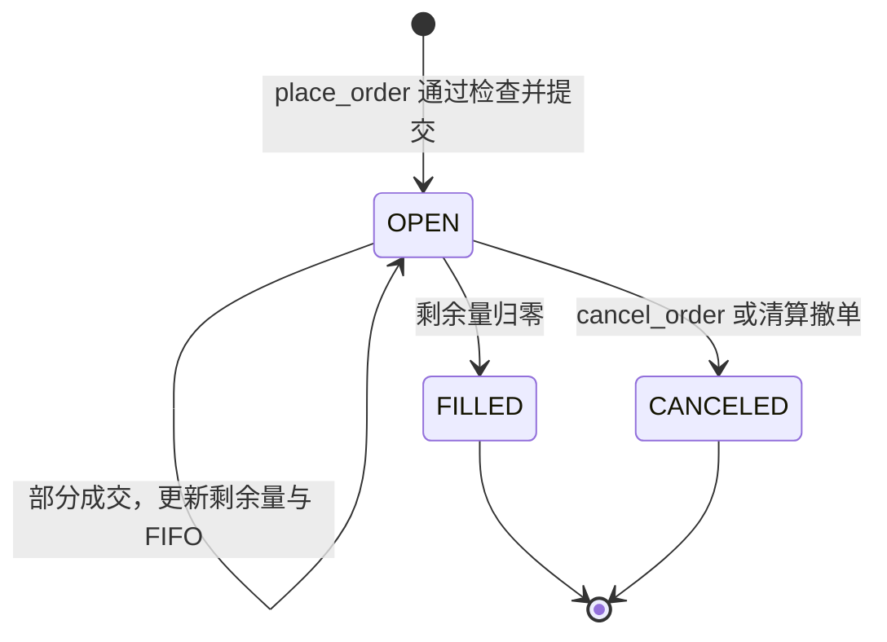
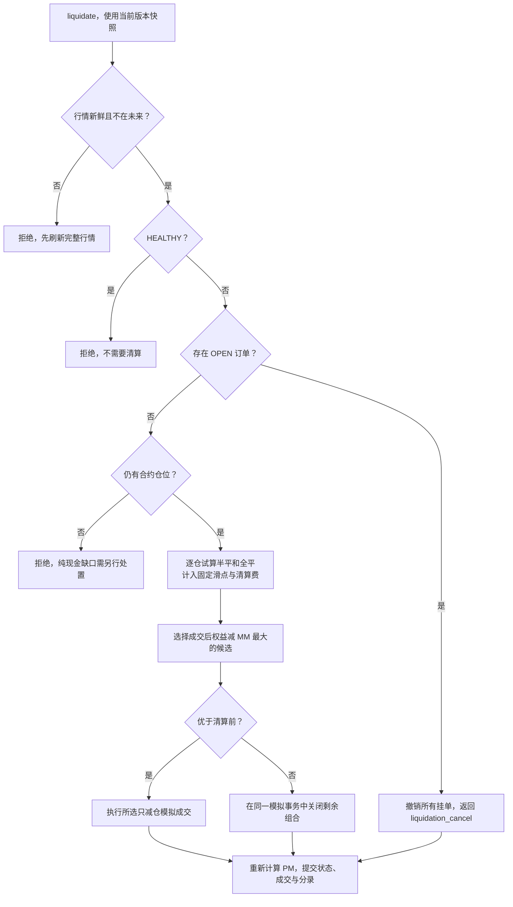
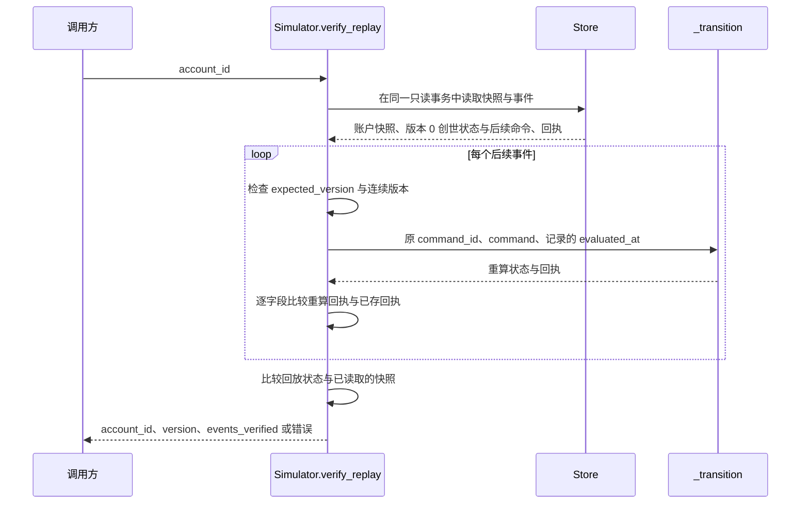

# 账户、订单、清算与回放流程

本页描述 [持久化模拟器](../uta/simulator.py) 的当前行为。事务时序和分片原子性见 [架构](architecture.md)，输入、错误码与重试方式见 [API](simulator.md)，保证金公式见 [风险模型](risk-model.md)。图中的成交由本地命令模拟，不代表外部交易所执行。

## 经典账户导入



依据：[build_shadow](../uta/migration.py)、[convert_shadow](../uta/shadow_adapter.py)、[Simulator.import_classic](../uta/simulator.py)、[Store.create](../uta/store.py)。后续数值、PM 或数据库检查失败也不会创建部分账户。

导入接受的源快照年龄为 0–30 秒，未来时间不被接受；独立 `build_shadow` 的默认未来容差为 2 秒，但导入入口显式设为零。来源版本和摘要是溯源信息，不会把目标账户版本初始化为来源版本。

导入保留 `captured_at` 作为账户行情时间，但价格、折扣与合约参数来自模拟器配置，不是源快照采集的市场报价。非零冻结余额一律拒绝；零冻结也不能证明源账户没有挂单，因为源 schema 不含订单明细。目标账户的空订单簿只属于新模拟环境。该入口不执行资金迁移、持续同步或线上切换。

## 订单生命周期与成交



下单只建立挂单和预占，不自动撮合。订单 ID 等于下单命令 ID；后续成交和撤单使用新的命令 ID，并引用这个订单 ID。`fill_order.quantity` 必须为正，方向继承挂单；成交不能超过剩余量，也不能突破买单最高限价或卖单最低限价。

成交先按 FIFO 处理平仓和可能的新开仓，精确保存有符号入场成本，再计入实现损益与手续费。每笔成交的 `journal` 中，`user_net_usd` 的变化为实现损益减费用，对手科目分别为 `simulated_clearing` 和 `fees`；没有损益和费用时可以没有分录。全部状态、剩余量、PM 和回执一起通过账户事务提交。终态订单快照只保留最近 100 条，已提交事件与命令回执不因该清理被删除。

依据：[_place / _fill / _trade / _transition](../uta/simulator.py)；验证见 [test_simulator.py](../tests/test_simulator.py)、[test_server.py](../tests/test_server.py)。

## 清算选择与有界推进

`_health` 先检查行情时间：行情在未来或年龄超过 5 分钟时为 `STALE`；否则权益非正为 `INSOLVENT`，正权益小于等于 MM 为 `BREACH`，其余为 `HEALTHY`。健康状态是每次计算的结果，没有单独持久化的清算阶段队列。



依据：[_health / _liquidate / _mark_and_liquidate](../uta/simulator.py)。半平数量向下对齐 0.000001；清算成交以标记价加 0.5% 不利滑点，费率为 0.2%。单次 `liquidate` 提交一次撤单动作或一次减仓动作，之后调用方需读取新状态，必要时继续发命令。它不等待外部撤单确认。

`mark_and_liquidate` 先更新完整报价，再在同一次账户事务内推进最多 8 个动作。达到健康状态，或没有仓位和挂单时停止；仍有待处理敞口则回执标记 `liquidation_pending`，下一命令从新版本继续。这里的 8 次是内部动作预算，不是 8 次独立提交。

平仓后仍可能欠账：负现金增加 USD 显式负债，账户可保持 `INSOLVENT`。因此 `liquidation_pending=false` 表示当前没有待推进的持仓或挂单，或账户已经健康，不表示债务已消除。测试情景刻意保留欠账，未包含保险基金或 ADL。

## 审计回放与恢复核对



回放在同一只读事务内获取快照与事件，关闭事务后使用命令原来的决策时间重算，避免重启后把历史行情误判为过期。结果返回此次核对的账户版本，后续提交会在下次回放中核对。核对范围是当前模型、参数与已记录的命令和快照之间的一致性。

下面的第二条命令使用保留下来的数据库、账户和相同分片数。实现见 [Simulator.verify_replay](../uta/simulator.py) 和 [Store.read_for_replay](../uta/store.py)。

```bash
python -m uta scenario --db exercise.sqlite3 --account shock-demo --shards 4
python -m uta replay --db exercise.sqlite3 --account shock-demo --shards 4
```

情景会创建新账户；同名账户已存在时不会覆盖，需选择新账户 ID。纯内存 `LiquidationController` 的动作确认和 1.10 倍恢复缓冲不属于上述流程，其边界见 [风险模型](risk-model.md)。
